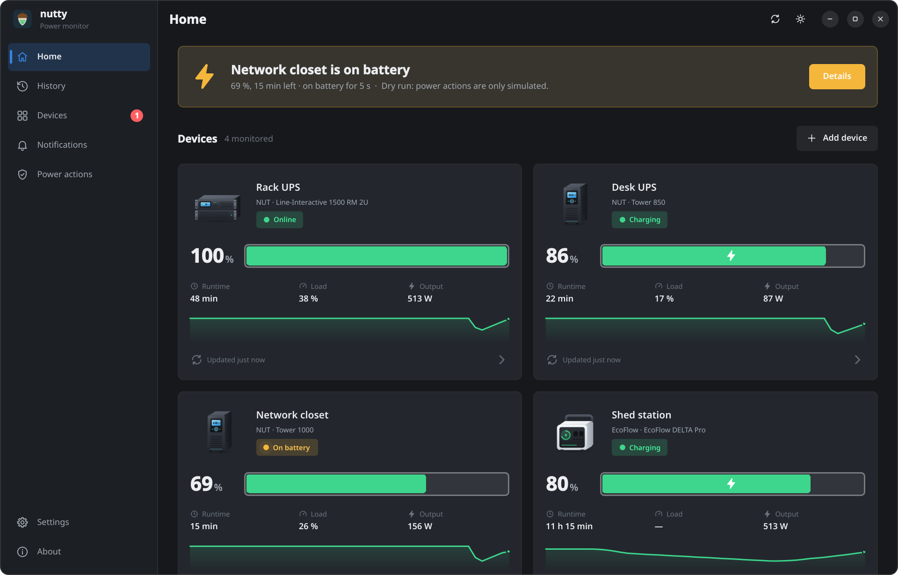
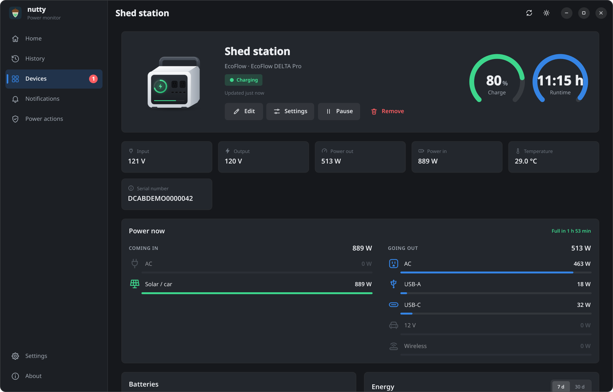
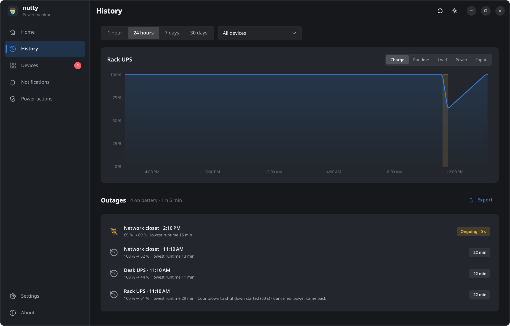
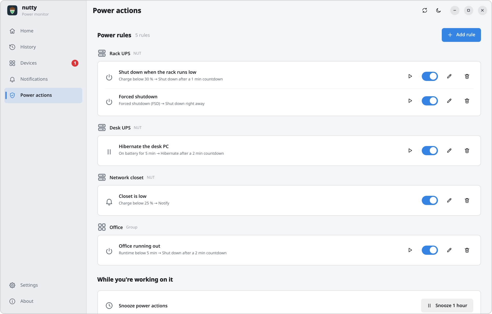
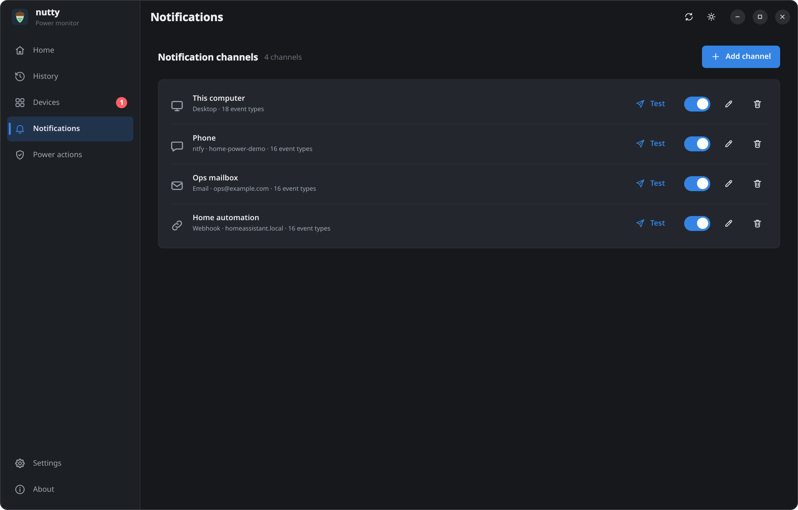
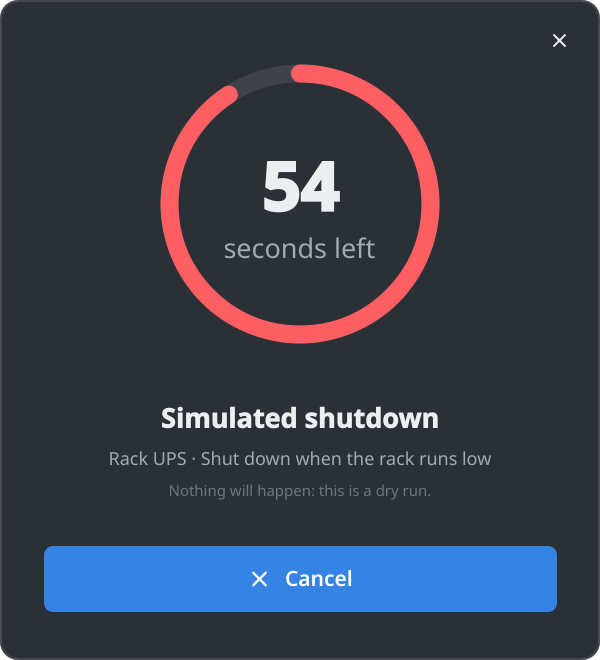

<p align="center">
  
</p>

<h1 align="center">nutty</h1>

<p align="center">
  A small tray app that watches your UPS units, power stations and batteries,<br>
  tells you when the power changes, and puts the computer to sleep or shuts it
  down before the battery runs out.
</p>

<p align="center">
  <picture>
    <source media="(prefers-color-scheme: light)" srcset="docs/screenshots/home-light.png">
    
  </picture>
</p>

nutty is a native Qt 6 app for **Windows, macOS and Linux** (x86_64 and arm64).
It lives in the system tray. Open the window to see every device at a glance:
charge, runtime, load and power in and out, with a picture of the device. It also
keeps a dated log of everything that happened to each one.

## Screenshots

| | |
|---|---|
|  |  |
| **A power station**: what's coming in and going out, each battery, energy per day and its settings ([whole page](docs/screenshots/ecoflow-full-light.png)) | **History**: charts, outages and every event |
|  |  |
| **Power actions**: what to do, and when, per device or group | **Notifications**: desktop, phone, email, webhooks and more |

<p align="center">
  <br>
  <sub>Power actions count down first, so there's time to cancel. A forced shutdown from the UPS doesn't wait.</sub>
</p>

The data in these is made up. `scripts/screenshots.py` renders them again from
simulated devices, without touching your own settings or history.

## Features

- **Many devices at once, from many sources**
  - **NUT** (Network UPS Tools): local or remote `upsd`, with optional STARTTLS
    and certificate pinning, UPS discovery, and an optional `upsmon secondary`
    login so the NUT primary waits for nutty before it powers off.
  - **EcoFlow** power stations, through EcoFlow's official IoT Open Platform
    (your own access and secret key). On a DELTA Pro, the device page also
    shows each battery pack, where the power comes from and goes, and the
    energy in and out each day, and can change the unit's settings: outputs,
    X-Boost, charging speed, charge limits, backup reserve, timeouts and
    more. nutty asks before every change, and twice before one that can cut
    power. Dry run doesn't cover these; a change you confirm is sent.
  - **apcupsd** over its network information server (NIS).
  - **The OS's own power sources**: laptop batteries and USB HID UPS units, via
    UPower, IOKit or Win32.
  - **Any HTTP/JSON endpoint**, with a Home Assistant preset.
- **Notifications** when a device goes on battery, runs low, needs a new
  battery, loses contact and so on. They can go to the desktop, **Pushover**,
  **ntfy**, **email** (SMTP with STARTTLS or TLS), **webhooks** (Discord,
  Slack and Teams presets, or your own JSON template) and **PagerDuty**, whose
  alerts resolve themselves when power or contact comes back. Each channel
  picks which events it gets and has a Test button.
- **Power actions per device**: sleep, hibernate, shut down or run a command
  when a device has been on battery for N minutes, drops below N % or
  N minutes of runtime, reports a low battery, or loses contact while on
  battery. Rules can also target a group of devices, e.g. "shut down when
  *all* of these are critical".
  - **Countdowns**: a cancellable countdown, which nutty shortens when the
    battery won't last that long.
  - **Forced shutdown**: when the UPS signals one (FSD), nutty acts at once.
  - **No accidental shutdowns**: each rule fires once per outage, brief
    brownouts don't restart the clock, and nothing fires on stale data after
    the computer wakes up.
  - **Dry run**: try every rule without the computer actually going down.
- **Home screen**: a live card per device with its picture, an animated
  battery, charge, runtime, load and power, a 24-hour sparkline and when it
  last updated. Recent activity sits below the cards.
- **History**: charge, runtime, load, power and input voltage charts; a list
  of outages showing how long each lasted, the lowest charge and what nutty
  did; and an event log you can filter by kind or search. Pick a device and a
  span from the last hour to 30 days. Outages and events export to CSV.
- **Feels at home on each OS**:
  - **Light and dark**: follows the system theme, or you can force either.
  - **Native window effects**: Mica on Windows 11 and vibrancy on macOS.
  - **Linux**: a crisp custom title bar that scales properly on KDE and GNOME.
  - **Motion**: animations follow the OS's reduce-motion setting.
- **Secrets stay in the OS keychain**: Credential Manager, the macOS Keychain,
  or the Secret Service (GNOME Keyring and KWallet).
- **Lightweight**: starting into the tray loads no UI at all. The window's
  QML is loaded when you open it and freed again when you close it, unless
  you turn on **Keep window loaded**.

## Install

Grab a package from the [Releases](https://github.com/ProjectHax/nutty/releases):

- **Linux** (x86_64 and aarch64)
  - `.deb` for Ubuntu 24.04+ and Debian 13+.
  - `.rpm` for Fedora 40+ and RHEL 10+.
  - `.AppImage` or `.flatpak` for any other distribution.
- **macOS** (universal, Intel and Apple Silicon, macOS 13+): `.dmg` or `.zip`.
- **Windows** (x64 and arm64, Windows 10+): an installer (`-setup.exe`,
  per-user, no admin rights needed) or a portable `.zip`.

### Notes per platform

- **Linux**
  - **Tray**: nutty uses the StatusNotifierItem tray. GNOME needs the
    [AppIndicator extension](https://extensions.gnome.org/extension/615/appindicator-support/);
    without a tray, nutty runs as a normal window.
  - **Power actions** go through systemd-logind, so the usual polkit rules
    apply. If your session isn't allowed to suspend or power off, nutty says
    so when you set up a rule for it.
  - **Flatpak**: "Run command" runs inside the sandbox.
- **macOS**
  - **Shutdown permission**: shutting down asks macOS for permission to control
    System Events the first time. Press **Ask now** on the Power actions page
    so the question comes while you're there, not during an outage.
  - **No hibernate**: macOS doesn't offer it.
- **Windows**: notifications are the tray's toasts, which have no buttons.
  Cancel a countdown from its window or from the tray menu instead.

## Getting started

1. Open nutty from the tray and add a device on the **Devices** page.
   - **NUT**: enter the server and port (3493). **Find devices** lists the UPS
     names the server knows.
   - **EcoFlow**: paste the access and secret key from the EcoFlow developer
     portal, then pick the device by serial number.
   - **More devices on the same account or server**: a new EcoFlow device
     starts with the keys of the last one, and a new NUT device with its
     server and login. The devices found there are listed right away, and the
     ones already added show as "Added". Change the keys on one device and
     nutty offers to change them on the others too.
2. Add notification channels on the **Notifications** page and press **Test**.
3. Set up rules on the **Power actions** page. **Simulate** runs a rule's
   countdown without doing anything.

To try nutty without a UPS, run the fake NUT server and add a NUT device for
`localhost:3493`:

```sh
scripts/fake-upsd.py --ups ups --ups rack
```

Then type `ob`, `lb`, `fsd` or `ol` into it to play out an outage (add a UPS
name, like `ob rack`, to change just that one). Start nutty with
`NUTTY_DRY_RUN=1` (or `--dry-run`) so the actions only get logged.

### Where nutty keeps its files

| | Linux | macOS | Windows |
|---|---|---|---|
| Settings (`nutty.ini`) | `~/.config/ProjectHax/nutty` | `~/Library/Preferences/ProjectHax/nutty` | `%LOCALAPPDATA%\ProjectHax\nutty` |
| History (`history.db`) and pictures | `~/.local/share/ProjectHax/nutty` | `~/Library/Application Support/ProjectHax/nutty` | `%APPDATA%\ProjectHax\nutty` |

Passwords and keys are kept in the OS keychain, not in these files. If no
keychain is available, they go in `secrets.json` next to the history, readable
only by you, and nutty warns about it in Settings. `--config-dir <dir>` keeps
the settings, history and pictures in one folder instead.

## Build from source

You need:

- **CMake 3.21 or newer** and a **C++23** compiler: GCC 14, MSVC 17.10 or
  Apple Clang 16.
- **Qt 6.4 or newer**, with Qt Quick, Qt Quick Controls, Qt SVG, Qt Shader
  Tools, Qt SQL (SQLite) and the Qt Linguist tools.

```sh
cmake --preset dev
cmake --build --preset dev
ctest --preset dev
```

The `release` preset is an optimized build without the tests.

### Linux build dependencies

On Ubuntu 24.04:

```sh
sudo apt-get install -y g++-14 cmake ninja-build \
  qt6-base-dev qt6-base-dev-tools qt6-declarative-dev qt6-declarative-dev-tools \
  qt6-shadertools-dev qt6-svg-dev qt6-tools-dev qt6-tools-dev-tools qt6-l10n-tools \
  libqt6sql6-sqlite qt6-qpa-plugins libgl-dev libvulkan-dev \
  qml6-module-qtquick qml6-module-qtquick-controls qml6-module-qtquick-templates \
  qml6-module-qtquick-layouts qml6-module-qtquick-shapes qml6-module-qtquick-window \
  qml6-module-qtqml-workerscript qml6-module-qtqml-models qml6-module-qttest
cmake --preset dev -DCMAKE_CXX_COMPILER=g++-14
```

On Fedora:

```sh
sudo dnf install -y gcc-c++ cmake ninja-build \
  qt6-qtbase-devel qt6-qtdeclarative-devel qt6-qtshadertools-devel \
  qt6-qtsvg-devel qt6-qttools-devel
```

`.github/workflows/ci.yml` has the exact package sets CI uses.

## Translations

The UI strings live in `i18n/nutty_<lang>.ts`. To update them after you change
any strings:

```sh
python3 scripts/translate.py           # lupdate, then translate what's new
python3 scripts/translate.py --check   # fail if any catalog is incomplete
```

`translate.py` runs `lupdate` over `src/` and sends the unfinished messages to
`claude -p` in batches. Before writing anything back, it checks that every
placeholder, plural form and mnemonic survived.

## License

Copyright (C) 2026 ProjectHax LLC.

nutty is free software, released under the [GNU General Public License v3.0](LICENSE).
